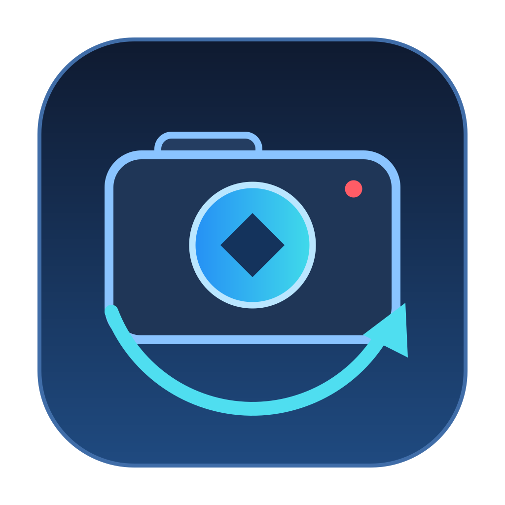

# Tesla Dashcam Recovery — macOS · PL / EN



macOS port of [Arquiteto/tesla-dashcam-recovery](https://github.com/Arquiteto/tesla-dashcam-recovery). Recover existing and deleted Tesla Dashcam / Sentry clips, prepare playable videos and review up to six camera views. The original recovery, decryption and repair engines are retained, with macOS integration and interface improvements.

**[Download macOS 0.3.0](https://github.com/oliwieremk/tesla-dashcam-recovery/releases/tag/macos-v0.3.0)** · **[Instrukcja po polsku](README-MAC-PL.md)** · **[English instructions](README-MAC-EN.md)**

> Early macOS release: 18 automated tests passed and the native app was checked on Apple Silicon. Physical Tesla USB recovery, Tesla account authentication/key retrieval, real six-camera synchronization and Intel hardware still need end-to-end validation. Deleted footage may already have been overwritten.

## Po polsku

Wersja na Maca oparta na projekcie Arquiteto, z interfejsem **PL / EN**, własną ikoną i czytelniejszymi przyciskami. Odnajduje nagrania istniejące oraz dane po skasowanych plikach, pozwala wybrać zakres czasu, skopiować nagrania na Maca, przygotować je i obejrzeć w siatce lub powiększeniu.

1. Pobierz `tesla-recovery-macos-pl-en.zip` z **Releases** i rozpakuj.
2. Uruchom **Tesla Recovery.app**. Pierwszy start pobiera składniki i wymaga internetu.
3. Podłącz USB Tesli, wybierz źródło i skanuj. Zgoda administratora służy do odczytu zewnętrznego nośnika.
4. Wybierz zakres czasu i folder docelowy na Macu, następnie skopiuj nagrania.
5. Tylko dla zaszyfrowanych nagrań: zaloguj się do Tesli lub wklej token, aby pobrać klucze. Przygotuj nagrania i otwórz odtwarzacz.

Pełna instrukcja, uprawnienia macOS, skróty i ograniczenia: **[README-MAC-PL.md](README-MAC-PL.md)**.

## What changed in this fork

- Native universal `.app` launcher for macOS 13+, with an original icon and first-run setup.
- External FAT32/exFAT USB discovery through `diskutil`; a short privileged helper opens the selected external partition **read-only**, then hands access to the ordinary-user app.
- Guards against writing prepared or exported files to the source Tesla volume; release/remount controls.
- Persistent Polish/English UI, progress messages, quality labels and native menus. Switching preserves selection and playback position.
- Clearer dark interface, explicit high-contrast button states, keyboard focus, day filters and timeline zoom.
- Partial/repaired/unplayable indicators, partition-image validation, macOS folder pickers and Finder integration.
- macOS Chrome/Edge/Chromium discovery; settings and runtime stored outside the app bundle.
- Automated coverage for scan/export, MP4 repair, synthetic decryption, read-only access, localization and source protection.

The viewer has **six camera positions**: front, back, left/right repeaters and left/right pillars. It shows available recovered clips; missing or unusable recordings cannot be recreated. Telemetry appears when present in the footage.

## Requirements and privacy

- macOS 13 or newer; Apple Silicon tested, Intel launcher included but hardware untested.
- Internet for initial dependencies and Tesla keys. Plain footage processing is local after setup.
- Free storage for recovered and prepared copies; Chrome/Edge or downloadable Chromium for Tesla sign-in.
- For encrypted footage, a Tesla account authorized to retrieve the clip keys.

The source USB is read-only. Output videos are saved to your chosen folder. Tesla receives requests needed to obtain decryption keys; videos are decrypted locally. The token is held in memory rather than app settings; the dedicated browser profile may retain sign-in data. Stop using the USB in the car before recovery because new recordings can overwrite deleted data.

The app is **ad hoc signed, not notarized**. See the instructions if macOS blocks opening it. No recordings, account data or tokens are included in the release.

## Verification

**18 tests passed** on macOS Apple Silicon, with FFmpeg/FFprobe available. Tests include byte-identical export from a synthetic exFAT image, decoding prepared MP4, rebuilding a missing MP4 index and synthetic AES decryption. Native checks covered playback, PL/EN switching without losing state, Finder icon and bundle signing.

Physical USB authorization/recovery, real Tesla authentication/decryption, Intel hardware and real multi-camera telemetry/sync remain unverified. See [full test report (PL)](docs/VERIFICATION-PL.md).

## Run and build from source

Install [uv](https://docs.astral.sh/uv/getting-started/installation/) and clone this fork:

```bash
git clone https://github.com/oliwieremk/tesla-dashcam-recovery.git
cd tesla-dashcam-recovery
./"Tesla Recover.command"
```

For an uncompressed **FAT32/exFAT partition image** or an existing library:

```bash
./"Tesla Recover.command" --image "/path/to/partition.img"
./"Tesla Recover.command" --library "/path/to/recovered-library"
```

Whole-disk GPT/MBR images and compressed DMG images are unsupported.

Build the universal launcher with Xcode Command Line Tools installed:

```bash
uv run python macos/build_app.py dist
codesign --verify --deep --strict "dist/Tesla Recovery.app"
```

Run tests (FFmpeg and FFprobe required for multimedia tests):

```bash
uv run python -m unittest discover -s tests -v
```

Windows retains `Tesla Recover.bat`; this fork has not been regression-tested on Windows hardware. Linux USB discovery is unsupported. The [legacy guide](docs/UPSTREAM-GUIDE.md) documents the original workflow, with notes added during the port.

## Credits and license

Original app and recovery workflow: **[Arquiteto](https://github.com/Arquiteto/tesla-dashcam-recovery)**. macOS port and PL/EN interface published by **[oliwieremk](https://github.com/oliwieremk)**. Decryption code: **[XGxF3/tesla-dashcam-decrypt](https://github.com/XGxF3/tesla-dashcam-decrypt)**.

[MIT license](LICENSE), with original copyright notices retained. Independent, unofficial software; not affiliated with Tesla.
